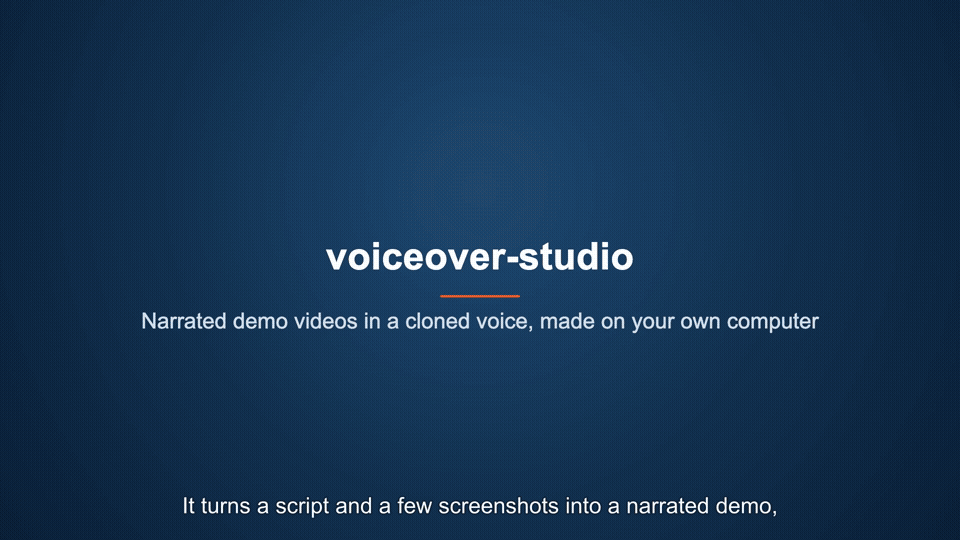

# voiceover-studio

Make narrated product-demo videos in **Bangla or English**, using a **cloned voice**. Everything runs on your own machine: no cloud TTS service and no per-minute fees.

You provide a script, some screenshots and a short voice recording. You get back a 1080p MP4 with:

- narration in the cloned voice (zero-shot cloning; nothing is trained)
- highlight boxes that light up as each element is mentioned
- burned-in captions, synced phrase by phrase
- title and closing cards, step-by-step process diagrams and picture-in-picture insets

## Demo

[](docs/media/demo-en.mp4)

▶ Watch with sound: **[English demo](docs/media/demo-en.mp4)** (49 s) · **[Bangla demo](docs/media/demo-bn.mp4)** (48 s)
🔊 Just the voices: [English sample](docs/media/sample-en.mp3) · [Bangla sample](docs/media/sample-bn.mp3)

Both videos were made with voiceover-studio itself:
- **English:** Chatterbox's built-in voice
- **Bangla:** the bundled open-corpus voice, `voices/speaker-00737`

Their projects are in [examples/](examples/), so you can rebuild them or copy one to start your own.

```
pitch.md ──narrate──▶ narration/*.wav + timings.json ─┐
project.json ──cards──▶ cards/*.png ──────────────────┼──build──▶ video.mp4
shots/*.jpg + cues.json ──────────────────────────────┘
```

| Language | Engine | Voice cloning | Licence |
|----------|--------|---------------|---------|
| Bangla (`"language": "bn"`, the default) | [IndicF5](https://github.com/AI4Bharat/IndicF5) | from 8-12 s of speech **plus its exact transcript** | MIT |
| English (`"language": "en"`) | [Chatterbox Turbo](https://github.com/resemble-ai/chatterbox) | from 5+ s of speech, no transcript; or its built-in voice | MIT |

Any voice can speak either language. A Bangla speaker's clip can narrate in English, and the reverse. **You choose at install time which languages to set up: Bangla, English or both.** Each needs only its own engine (see [Install, step 3](#3-run-the-setup-script)).

## Requirements

- macOS (Apple Silicon recommended) or Linux (an NVIDIA GPU is optional; CPU works, just much slower). On Windows, use WSL2 with Ubuntu and follow the Linux steps.
- **Python 3.12**, a recent patch release (3.12.13 or later is known to work)
- ffmpeg with libass, and Google Chrome or Chromium
- free disk space: about 6 GB for Bangla only, 8 GB for English only, 13 GB for both (each a bit less with `WITH_ASR=0`)
- 8 GB of RAM (16 GB recommended)

## Install

### 1. Clone

```bash
git clone https://github.com/arafat1023/voiceover-studio.git
cd voiceover-studio
```

### 2. Install the system tools

**macOS** (with [Homebrew](https://brew.sh)):

```bash
brew install python@3.12 ffmpeg
brew install --cask google-chrome      # skip if Chrome is already installed
```

**Ubuntu 24.04+ / Debian / WSL2:**

```bash
sudo apt update
sudo apt install python3.12 python3.12-venv ffmpeg fontconfig curl git
# Ubuntu 22.04 has no python3.12: first run  sudo add-apt-repository ppa:deadsnakes/ppa
# Debian 12 has no python3.12: use  uv python install 3.12  (https://docs.astral.sh/uv/) or pyenv
# Chrome (x86_64):
wget https://dl.google.com/linux/direct/google-chrome-stable_current_amd64.deb
sudo apt install ./google-chrome-stable_current_amd64.deb
# ...or Chromium on Debian or ARM: sudo apt install chromium
```

**Fedora:** `sudo dnf install python3.12 chromium`, plus ffmpeg from [RPM Fusion](https://rpmfusion.org/Configuration).

### 3. Run the setup script

**Choose your languages.** Install only what you need:

| You want | Command | Disk space (approx.) |
|----------|---------|----------------------|
| Bangla and English (default) | `./setup.sh` | 13 GB |
| Bangla only | `LANGUAGES=bn ./setup.sh` | 6 GB |
| English only | `LANGUAGES=en ./setup.sh` | 8 GB |

**Add a language later** by running setup again with that language, e.g. `LANGUAGES=en ./setup.sh` on a Bangla-only install. It adds English and keeps everything already installed. Nothing is ever removed; to drop a language, delete `.venv` and run setup again with only the languages you want. A project in a language that isn't installed stops with a message telling you which command adds it.

**Then add your hardware option** to the same command if needed:

```bash
./setup.sh                    # macOS, or Linux with an NVIDIA GPU (driver 580+)
TORCH_CUDA=cu126 ./setup.sh   # Linux with an NVIDIA GPU on an older driver (about 525-579)
TORCH_CPU=1 ./setup.sh        # Linux without an NVIDIA GPU (much smaller PyTorch download)
```

Both kinds of option combine, e.g. `LANGUAGES=en TORCH_CPU=1 ./setup.sh` for English only on a Linux machine without a GPU.

At the end, setup prints the device the voice models will use: `mps` (Apple Silicon), `cuda` (NVIDIA) or `cpu`. If there's an NVIDIA GPU that PyTorch can't use, it says why and how to fix it. Run the same check any time with `.venv/bin/python -m studio.device`.

**NVIDIA GPUs on Linux.**
- The default PyTorch for Linux is built for CUDA 13, which needs NVIDIA driver **580 or newer**. Check yours with `nvidia-smi`. On an older driver, use `TORCH_CUDA=cu126` (CUDA 12.6), or update the driver.
- Without a working GPU everything still runs on the CPU, just much more slowly: a long video can take hours instead of minutes.
- To switch PyTorch builds later, delete `.venv` first (`rm -rf .venv`), because setup keeps an existing PyTorch.
- *Not tested on real hardware yet:* GPU on Linux uses the standard PyTorch CUDA builds and the device is picked automatically, but this project has so far been tested on Apple Silicon and on CPU-only Linux. Reports from NVIDIA users are welcome.

If a system tool is missing, `setup.sh` stops and prints the exact install command for your OS. Fix it and run the script again; it skips anything already done. If `python3.12` isn't on your PATH (pyenv, uv), point at it: `PYTHON=/path/to/python3.12 ./setup.sh`.

### What gets downloaded

You never download any of these by hand; `setup.sh` fetches only what your chosen languages need.

| What | Needed for | Size | From | Where it goes |
|------|------------|------|------|---------------|
| Shared Python packages (PyTorch, transformers, …) | both | ~1-3 GB | PyPI, pytorch.org | `.venv/` |
| IndicF5 code + its packages | Bangla | ~0.3 GB | GitHub, PyPI | `.venv/` |
| IndicF5 model weights | Bangla | 1.3 GB | [rsolanki1822/IndicF5-mirror](https://huggingface.co/rsolanki1822/IndicF5-mirror) | `models/indicf5-base/` |
| Vocos vocoder | Bangla | 50 MB | [charactr/vocos-mel-24khz](https://huggingface.co/charactr/vocos-mel-24khz) | `~/.cache/huggingface/` |
| Kalpurush font (only if missing) | Bangla | 300 KB | [omicronlab.com](https://www.omicronlab.com/bangla-fonts.html) | `~/Library/Fonts` (macOS), `~/.local/share/fonts` (Linux) |
| Bengali Whisper (optional) | Bangla | 3 GB | [bengaliAI/tugstugi_bengaliai-asr_whisper-medium](https://huggingface.co/bengaliAI/tugstugi_bengaliai-asr_whisper-medium) | `~/.cache/huggingface/` |
| Chatterbox code + its packages | English | ~0.2 GB | PyPI | `.venv/` |
| Chatterbox Turbo model | English | ~4 GB | [ResembleAI/chatterbox-turbo](https://huggingface.co/ResembleAI/chatterbox-turbo) | `~/.cache/huggingface/` |
| Whisper small (optional) | English | 1 GB | [openai/whisper-small](https://huggingface.co/openai/whisper-small) | `~/.cache/huggingface/` |

The Whisper models are optional helpers. They draft the transcript when you make a voice, and they check each narrated phrase when a project sets `"retakes"`.

Options, set before `./setup.sh`:

| Variable | Effect |
|----------|--------|
| `LANGUAGES=bn` / `en` / `bn,en` | which language engines to install (default `bn,en`). Running again with another language adds it |
| `TORCH_CPU=1` | CPU-only PyTorch (Linux) |
| `TORCH_CUDA=cu126` | PyTorch built for CUDA 12.6 instead of 13 (Linux, NVIDIA driver older than 580). Any build listed at https://download.pytorch.org/whl/ works, e.g. `cu130` |
| `WITH_ASR=0` | skip the Whisper models (saves 3 GB for Bangla, 1 GB for English) |
| `INDICF5_REPO=ai4bharat/IndicF5` | use the official model instead of the mirror. It's gated: first accept its terms on [the model page](https://huggingface.co/ai4bharat/IndicF5), then run `.venv/bin/hf auth login` |
| `PYTHON=/path/to/python3.12` | use a specific Python 3.12 |

Optional, downloaded by hand only if you need them:

- **OpenSLR SLR37** (560 MB): only needed to pick a *different* Bangla stock voice. Download it with `curl -LO https://www.openslr.org/resources/37/bn_bd.zip && unzip -q bn_bd.zip -d data/slr37-bn-bd`, then run `.venv/bin/python tools/pick_stock_speaker.py data/slr37-bn-bd`. The guide explains how to turn a speaker into a voice.
- **[Claude in Chrome](https://claude.ai/chrome)**: only if you want Claude Code to take the screenshots for you (see the guide).

### 4. Test it

Setup prints the test commands for the languages you installed:

```bash
.venv/bin/python -m studio.speak voices/speaker-00737 "আসসালামু আলাইকুম।" test-bn.wav            # Bangla
.venv/bin/python -m studio.speak builtin "Welcome to the demo." test-en.wav --language en      # English
```

The first run loads the model, which takes about 30 s. After that, a sentence takes about 5-10 s on Apple Silicon or a GPU, and 20-60 s on a CPU.

## Quick start

**1. Make a voice.** You need the speaker's consent (see below) and 8-12 s of clean speech. You can skip this step and use a bundled voice: `voices/speaker-00737` (Bangla stock voice) or `builtin` (English model's own voice).

```bash
.venv/bin/python -m studio.make_voice recording.m4a voices/alice                        # lists segments + draft transcripts
.venv/bin/python -m studio.make_voice recording.m4a voices/alice --start 3.9 --end 14.1 # cuts the reference clip
# Bangla: edit voices/alice/reference.txt so it matches the clip word for word
.venv/bin/python -m studio.speak voices/alice "আসসালামু আলাইকুম।" test.wav               # listen
```

Add `--language en` to both commands for an English recording.

**2. Start a project.**

```bash
cp -r projects/_template    projects/my-demo     # Bangla
cp -r projects/_template-en projects/my-demo     # English
```

Then fill in the project:
- In `project.json`, set `"voice"`.
- Write the script in `pitch.md`.
- Put screenshots in `shots/` and a logo at `assets/logo.png`.
- In `cues.json`, set which words trigger which highlight box.

**3. Build.**

```bash
.venv/bin/python -m studio.narrate projects/my-demo        # voice, scene by scene
.venv/bin/python -m studio.build   projects/my-demo --check
.venv/bin/python -m studio.cards   projects/my-demo
.venv/bin/python -m studio.build   projects/my-demo --only 2   # preview one scene
.venv/bin/python -m studio.build   projects/my-demo            # the full video
```

**[docs/GUIDE.md](docs/GUIDE.md)** walks through the whole process in detail:
- choosing a good voice clip
- writing a script the voice reads well
- fixing pacing and pronunciation
- capturing screenshots and measuring highlight boxes
- cards, process maps and insets
- which step to re-run after which change

## Repo layout

```
studio/         the pipeline: tts, narrate, cards, build, speak, make_voice, device, config
tools/          pick_stock_speaker.py: choose a voice from an open speech corpus
voices/         one folder per voice: reference.wav (+ reference.txt for Bangla) + README.txt
projects/       one folder per video; _template/ (Bangla) and _template-en/ (English) are the starters
examples/       the README demo projects (English and Bangla), complete and rebuildable
docs/           GUIDE.md (full workflow), MODELS.md (models, links, licences), media/ (demo videos)
.claude/skills/ the Claude Code skill (loaded automatically inside the repo)
setup.sh, requirements.txt (shared), requirements-bn.txt (Bangla), requirements-en.txt (English)
```

## Not in the repo

`.gitignore` keeps these out:

- `.venv/`, `models/`, `data/`: `setup.sh` recreates them.
- **Voice audio** (`voices/**/*.wav|m4a|mp3`). A voice belongs to a person. Share voice folders privately, and only with the speaker's agreement.
- **`voices/user-voice/`**, a colleague's voice used for our own demos. He agreed to that use, not to publishing his voice, transcript or name, so the whole folder stays local.
- **Projects** other than the two templates: they usually hold client screenshots, scripts and output.
- `*.mp4` output.

One voice **is** included: `voices/speaker-00737`. It comes from the open SLR37 corpus (CC BY-SA 4.0), so it can be shared as long as the credit is kept. The Bangla template uses it, and its `project.json` already carries the credit line. The English template uses `builtin`, which ships with the model.

## Package versions

Every Python package is pinned to its newest release that works with the rest. A few are held back on purpose, each with a comment in `requirements.txt` saying why. The root cause is numpy: IndicF5 requires numpy 1.26 or older, and its repo has been inactive since September 2025. That keeps:
- **Python at 3.12:** numpy 1.26 has no wheels for 3.13 or later.
- **`librosa`, `scipy` and `pyarrow` one step behind:** their newest releases need numpy 2.

`huggingface_hub` stays on 1.x because `cached-path` and `diffusers` require it. When IndicF5 supports numpy 2, those holds can be lifted. Chatterbox is installed with `--no-deps` because its own pins (torch 2.6, transformers 5.2) are older than what IndicF5 needs; it runs fine on the newer versions.

## Consent and attribution

- Clone a real person's voice **only with their explicit consent**, and record it in `voices/<name>/README.txt`: who they are, when they agreed and for what use.
- Don't use a cloned voice to make someone appear to say something they haven't approved.
- Don't present cloned speech as a live recording of them.
- English output from Chatterbox carries Resemble AI's inaudible [Perth watermark](https://github.com/resemble-ai/perth), so it can later be identified as AI-generated. Leave it in.
- Voices built from a licensed corpus must carry its credit line. For OpenSLR SLR37 (CC BY-SA 4.0), set `"credit": "Voice based on Google SLR37 Bengali speech data, CC BY-SA 4.0"` in `project.json`; the closing card prints it.

## Using with Claude Code

The repo includes a [Claude Code](https://claude.com/claude-code) skill, `narrated-demo-video`, that walks through the whole workflow for you.

**Install.** Nothing to do if you work inside the repo: Claude Code loads skills from the repo's `.claude/skills/` folder automatically. To use it from any other folder too, copy it to your user skills:

```bash
cp -r .claude/skills/narrated-demo-video ~/.claude/skills/
```

**Use.** Ask for something like *"Make a narrated demo video, in Bangla, of how to add a course in our admin panel."* You choose how involved to be:

| Mode | How to ask | What happens |
|------|------------|--------------|
| **Guided** (default) | just ask | Claude stops three times for you: to agree the story, to review the script, and to review a preview before the full build |
| **One-shot** | add "in one go" or "don't ask me" | Claude decides everything (language, voice, length, wording) and doesn't wait. Each choice is written to `projects/<name>/DECISIONS.md` with how to change it |
| **Custom** | name your checkpoints, e.g. "just show me the script first" | Claude stops only there |

If your request doesn't say, Claude asks once at the start. Either way the steps are the same:

1. agree the story, audience, length and language
2. pick or make a voice
3. write the script (`pitch.md`)
4. narrate, with Whisper checking each phrase
5. take the screenshots
6. write `cues.json`, measuring the highlight boxes from the screenshots
7. build the cards and a preview, and check the preview frames
8. build the full video and say what to listen for

If you run it from another folder, it finds the repo itself, or asks you where it is.

**What you need, and its limits:**
- **Screenshots** of a web app need the [Claude in Chrome](https://claude.ai/chrome) extension. Without it, Claude asks you for the screenshots and tells you which screens to capture.
- **Claude can't hear audio.** It checks words with Whisper, but you judge the voice, accent and pacing.
- **It always asks first, even in one-shot mode,** before cloning a real person's voice, large downloads (`setup.sh`, models), logging into a site, or when it needs screenshots it can't capture. It does everything else first, then asks these together.

## Licence

The code in this repo is MIT-licensed (see [LICENSE](LICENSE)). The models and the bundled voice keep their own licences; see [docs/MODELS.md](docs/MODELS.md).

## Credits

Built on:
- [IndicF5](https://github.com/AI4Bharat/IndicF5) (AI4Bharat, MIT)
- [F5-TTS](https://github.com/SWivid/F5-TTS) (MIT)
- [Vocos](https://huggingface.co/charactr/vocos-mel-24khz) (MIT)
- [Chatterbox](https://github.com/resemble-ai/chatterbox) (Resemble AI, MIT)

Optional:
- [Whisper](https://huggingface.co/openai/whisper-small) and [Bengali Whisper](https://huggingface.co/bengaliAI/tugstugi_bengaliai-asr_whisper-medium) for transcripts and take checks
- [OpenSLR SLR37](https://openslr.org/37/) for stock voices

Details are in [docs/MODELS.md](docs/MODELS.md).
